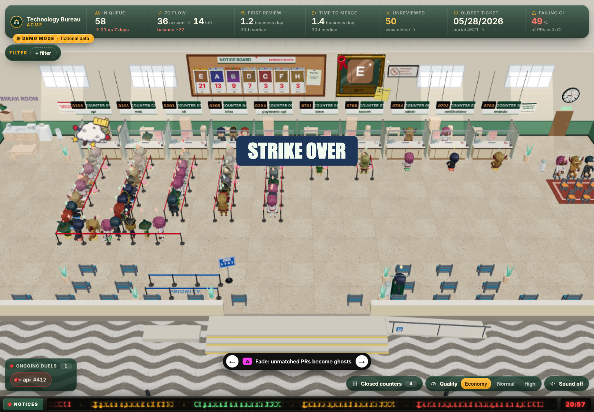

<div align="center">

# Pullbureau

**Pull requests, please take a number.**

Your GitHub organization's review queue, brought to life as a 3D public service office.

[](LICENSE)


[Try the demo](#quick-start) · [Connect your organization](#connect-your-organization) · [Deploy](#deploy) · [Português brasileiro](README.pt-BR.md)

</div>



Repositories become counters. PRs take a ticket and wait for review. Old requests sit down, fall asleep and gather dust. Between reviews, the office has coffee breaks, strikes, an optional helicopter inspection and the occasional duel.

Pullbureau is **self-hosted, with one GitHub organization per deployment**. You bring your organization and credentials; the live dashboard admits only members of that organization. The bundled demo runs entirely on fictional data.

## What happens in the office?

| In the scene | On GitHub |
| --- | --- |
| Counter | A repository and its review queue |
| Ticket number | A pull request number |
| In line | An open, non-draft PR carrying your readiness label |
| Waiting room | Drafts and PRs without that label |
| Attendants and notice board | Reviewers, activity and review rankings |

Select a PR to inspect its author, age, CI status and review timeline. The HUD tracks queue size, flow, review times and stalled work. You can follow a person, show closed counters, adjust rendering quality and enable sound.

English and Brazilian Portuguese are included. The organization name, readiness label, time zone and business hours are configurable. See the [vocabulary](GLOSSARY.md) for the scene's terminology.

## Quick start

You need **Node.js 22+**, **pnpm 11.22.0** (pinned in `package.json`) and a browser with WebGL.

Clone or fork this repository, enter its directory, then run:

```sh
pnpm install --frozen-lockfile
pnpm demo
```

Open [localhost:3000](http://localhost:3000). **No token, OAuth App or environment file is needed for the demo.** Sound becomes available after interacting with the page.

To try it in Portuguese:

```sh
LOCALE=pt-BR pnpm demo
```

## Connect your organization

### 1. Create your local configuration

```sh
cp .env.example .env.local
```

Fill in these values for live operation:

```dotenv
GITHUB_ORG=your-organization
GITHUB_TOKEN=replace-with-your-token
AUTH_SECRET=replace-with-a-random-secret
AUTH_GITHUB_ID=replace-with-your-oauth-client-id
AUTH_GITHUB_SECRET=replace-with-your-oauth-client-secret
AUTH_URL=http://localhost:3000
```

Generate a session secret with `openssl rand -base64 32`. Leave `DEMO_MODE` unset when connecting to real GitHub data. Startup reports missing required settings by name.

### 2. Register a GitHub OAuth App

In GitHub **Settings → Developer settings → OAuth Apps**, [create an OAuth App](https://docs.github.com/en/apps/oauth-apps/building-oauth-apps/creating-an-oauth-app) with:

| Setting | Local development |
| --- | --- |
| Homepage URL | `http://localhost:3000` |
| Authorization callback URL | `http://localhost:3000/api/auth/callback/github` |

Copy its client ID and client secret into `AUTH_GITHUB_ID` and `AUTH_GITHUB_SECRET`. For a deployment, use its HTTPS origin in both URLs and in `AUTH_URL`.

The OAuth login identifies the visitor. Pullbureau separately uses the server token to check membership in `GITHUB_ORG` before allowing access.

### 3. Configure the server token

For a fine-grained personal access token, select your organization as the resource owner and grant access to the repositories you want to display:

| Permission | Access |
| --- | --- |
| Organization: Members | Read |
| Repository: Pull requests | Read |
| Repository: Contents | Read |
| Repository: Actions | Read |
| Repository: Metadata | Read |

A classic PAT can use `read:org` and `repo` for private repositories. Organization approval and SSO authorization may also be required. The token must be able to read membership, PR data and workflow runs; see GitHub's [membership](https://docs.github.com/en/rest/orgs/members#check-organization-membership-for-a-user) and [workflow-run](https://docs.github.com/en/rest/actions/workflow-runs#list-workflow-runs-for-a-repository) documentation.

CI completion timestamps come from the REST Actions API. Available CI status information also depends on the token's access to commit checks and statuses.

### 4. Start the live dashboard

```sh
pnpm dev
```

Sign in with an account that belongs to your organization. Non-draft PRs labeled `ready-for-review` enter the counter queues; change `READY_LABEL` if your team uses another label.

> [!IMPORTANT]
> OAuth credentials, `GITHUB_TOKEN` and `AUTH_SECRET` stay on the server. Keep `.env.local` out of Git. Making the source public does not make your organization's live dashboard public.

## Configuration

Set presentation options before building:

```dotenv
ORG_DISPLAY_NAME=Acme Engineering
LOCALE=en
TIME_ZONE=UTC
BUSINESS_START_HOUR=9
BUSINESS_END_HOUR=18
READY_LABEL=ready-for-review
```

`ORG_DISPLAY_NAME` falls back to `GITHUB_ORG`. Leave `CTO_LOGIN` empty to omit the special inspector.

<details>
<summary><strong>All environment variables</strong></summary>

| Variable | Purpose / default |
| --- | --- |
| `GITHUB_ORG` | Required in live mode. Organization shown and checked for membership. |
| `GITHUB_TOKEN` | Required in live mode. Server-side GitHub API token. |
| `AUTH_SECRET` | Required in live mode. Session-signing secret. |
| `AUTH_GITHUB_ID` | Required in live mode. OAuth App client ID. |
| `AUTH_GITHUB_SECRET` | Required in live mode. OAuth App client secret. |
| `AUTH_URL` | Your application origin, such as `http://localhost:3000`. |
| `AUTH_TRUST_HOST` | Set `true` only behind a proxy with trusted host headers. |
| `ORG_DISPLAY_NAME` | Public office name. Defaults to `GITHUB_ORG`. |
| `LOCALE` | `en` (default) or `pt-BR`. |
| `TIME_ZONE` | IANA time zone. Default: `UTC`. |
| `BUSINESS_START_HOUR` | Opening hour in that time zone. Default: `9`. |
| `BUSINESS_END_HOUR` | Closing hour in that time zone. Default: `18`. |
| `READY_LABEL` | Label required to join a counter queue. Default: `ready-for-review`. |
| `CTO_LOGIN` | Optional inspector login. No default. |
| `IGNORED_LOGINS` | Comma-separated accounts ignored as bots. Default: `coderabbitai,sonarcloud,sonarqubecloud`. |
| `EXCLUDED_LOGINS` | Comma-separated accounts omitted from people and rankings. |
| `CHARACTER_OVERRIDES` | Optional JSON mapping of logins to IDs from `src/shared/characters.generated.json`. Leave empty for automatic assignment. |
| `DEMO_MODE` | `1` selects the fictional replay and denies live data APIs. `pnpm demo` sets it for you. |
| `ASSET_DIR` | Asset import scripts only. Source directory; can also be passed as an argument. |
| `E2E_BYPASS_AUTH` | Local nonproduction tests only. Requires a loopback request host and is blocked on known deployment hosts. Keep unset for deployments. |

</details>

> [!NOTE]
> Locale, display name, time zone, business hours, readiness label and demo mode are public build-time settings shared with the browser. **Rebuild after changing them.** Credentials are not part of this public configuration.

## Deploy

**Vercel:** import your fork using the Next.js preset. Set the live environment variables, production `AUTH_URL` and presentation settings before building. Configure the matching OAuth callback URL.

**A Node.js host:** install dependencies and configure the same environment, then run:

```sh
pnpm build
pnpm start --hostname 0.0.0.0
```

Serve it through an HTTPS reverse proxy. Keep `public/` and the bundled replay fixture with your deployment. Set `AUTH_TRUST_HOST=true` only when you trust the proxy's host headers. No AWS services are required.

To deploy **only the fictional demo**, set `DEMO_MODE=1` during both build and startup:

```sh
DEMO_MODE=1 pnpm build
DEMO_MODE=1 pnpm start
```

## Development

Built with Next.js 16, React 19, React Three Fiber, Three.js, Auth.js, Zustand, Vitest and Playwright.

```sh
pnpm lint
pnpm tsc --noEmit
pnpm test
DEMO_MODE=1 pnpm build
pnpm exec playwright install chromium
pnpm e2e
```

CI uses fictional demo data without real credentials. Live recordings may contain private information; keep them out of commits and issues. To regenerate the bundled fictional replay, run `pnpm make-demo`.

| Directory | Responsibility |
| --- | --- |
| `src/domain` | Queue, review, timing and event rules |
| `src/github` / `src/server` | GitHub integration, membership checks and caching |
| `src/client` | Live and replay data feeds |
| `src/scene` / `src/duel` | 3D scene and review duels |
| `src/i18n` / `src/types` | Translations and shared contracts |

<details>
<summary><strong>Scene controls and diagnostic URLs</strong></summary>

| Query | Effect |
| --- | --- |
| `?intro=0` | Skip the opening sequence. |
| `?replay=demo&speed=2` | Play the fictional replay at a chosen speed. In demo mode, the bundled replay is always selected. |
| `?hora=10:00` | Override the scene clock in the configured time zone. |
| `?fx=low` / `normal` / `high` | Choose rendering quality. |
| `?fiscalizacao=1` | Trigger the optional inspector early. |
| `?finisher=approved` / `closed` / `tbc` | Simulate a review-duel outcome. |
| `?egg=caramelo,sexta` | Trigger scene events: `caramelo`, `furafila`, `aniversario`, `sexta`, `baile`, `cafe`. |
| `?shot=1` | Preserve the canvas drawing buffer for screenshots. |
| `?variant=A` / `B` / `C` | Select a development filter prototype. |
| `?q=example` | Text query for filter prototype C. |

Filter keys: `author`, `reviewer`, `repo`, `age`, `ci`, `status`. Repeat a key to select multiple values. Sound requires browser interaction. If rendering is slow, try `?fx=low`.

</details>

**Get involved:** [Contributing](CONTRIBUTING.md) · [Code of conduct](CODE_OF_CONDUCT.md) · [Report a vulnerability](SECURITY.md)

**Credits:** code is [MIT licensed](LICENSE), © 2026 Felipe Ferrarini. Models and HDRIs are CC0; Inter uses OFL-1.1. See [asset credits and import instructions](public/CREDITS.md) and the [dependency license audit](docs/licenses/README.md), including dependencies under LGPL/MPL. Audio is synthesized in the browser. `private: true` in `package.json` prevents accidental npm publication.
