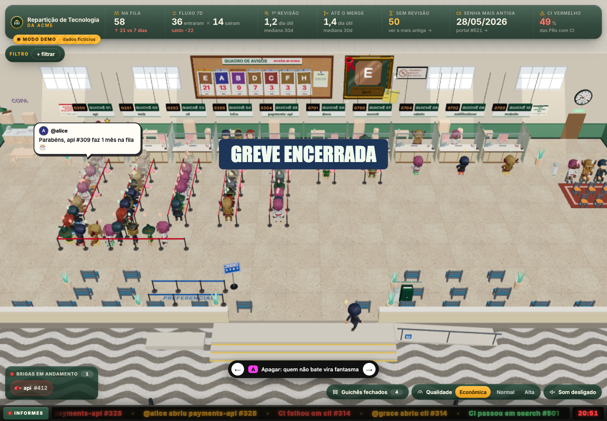

<div align="center">

# Pullbureau

**Pull requests, retirem suas senhas.**

A fila de revisão da sua organização no GitHub ganha vida em uma repartição pública 3D.

[](LICENSE)


[Experimentar a demo](#início-rápido) · [Conectar sua organização](#conectar-sua-organização) · [Deploy](#deploy) · [English](README.md)

</div>



Repositórios viram guichês. PRs retiram uma senha e aguardam revisão. Os mais antigos sentam, cochilam e acumulam poeira. Entre uma revisão e outra, tem café, greve, fiscalização opcional de helicóptero e até duelo.

O Pullbureau é **hospedado por você, com uma organização do GitHub por deploy**. Você configura sua organização e suas credenciais; o painel com dados reais aceita apenas membros dela. A demo incluída usa dados inteiramente fictícios.

## Como a repartição funciona?

| Na cena | No GitHub |
| --- | --- |
| Guichê | Um repositório e sua fila de revisão |
| Senha | O número de uma pull request |
| Na fila | Uma PR aberta, não rascunho, com o label de prontidão |
| Sala de espera | Rascunhos e PRs sem esse label |
| Atendentes e quadro de avisos | Revisores, atividade e ranking de revisões |

Selecione uma PR para ver autor, idade, estado do CI e histórico de revisões. O painel acompanha tamanho da fila, fluxo, tempos de revisão e trabalho parado. Também dá para seguir uma pessoa, mostrar guichês fechados, ajustar a qualidade gráfica e ativar o som.

Inglês e português brasileiro já estão incluídos. Nome da organização, label, fuso e horário comercial são configuráveis. O [glossário](GLOSSARY.md) registra os termos da cena.

## Início rápido

Você precisa de **Node.js 22+**, **pnpm 11.22.0** (versão fixada no `package.json`) e um navegador com WebGL.

Clone ou faça um fork deste repositório, entre na pasta e execute:

```sh
pnpm install --frozen-lockfile
pnpm demo
```

Abra [localhost:3000](http://localhost:3000). **A demo não precisa de token, OAuth App nem arquivo de ambiente.** O som fica disponível depois de interagir com a página.

Para experimentar em português:

```sh
LOCALE=pt-BR pnpm demo
```

## Conectar sua organização

### 1. Criar a configuração local

```sh
cp .env.example .env.local
```

Preencha estes valores para usar dados reais:

```dotenv
GITHUB_ORG=your-organization
GITHUB_TOKEN=replace-with-your-token
AUTH_SECRET=replace-with-a-random-secret
AUTH_GITHUB_ID=replace-with-your-oauth-client-id
AUTH_GITHUB_SECRET=replace-with-your-oauth-client-secret
AUTH_URL=http://localhost:3000
```

Gere o segredo de sessão com `openssl rand -base64 32`. Deixe `DEMO_MODE` desativado ao conectar dados reais do GitHub. A inicialização informa pelo nome qualquer configuração obrigatória ausente.

### 2. Registrar um OAuth App no GitHub

Em **Settings → Developer settings → OAuth Apps**, [crie um OAuth App](https://docs.github.com/en/apps/oauth-apps/building-oauth-apps/creating-an-oauth-app) com:

| Configuração | Desenvolvimento local |
| --- | --- |
| Homepage URL | `http://localhost:3000` |
| Authorization callback URL | `http://localhost:3000/api/auth/callback/github` |

Copie o client ID e o client secret para `AUTH_GITHUB_ID` e `AUTH_GITHUB_SECRET`. No deploy, use a origem HTTPS publicada nas duas URLs e em `AUTH_URL`.

O login OAuth identifica o visitante. Separadamente, o Pullbureau usa o token do servidor para verificar se ele pertence a `GITHUB_ORG` antes de liberar o acesso.

### 3. Configurar o token do servidor

Para um token pessoal refinado, selecione sua organização como proprietária do recurso e os repositórios que deseja exibir:

| Permissão | Acesso |
| --- | --- |
| Organização: Members | Leitura |
| Repositório: Pull requests | Leitura |
| Repositório: Contents | Leitura |
| Repositório: Actions | Leitura |
| Repositório: Metadata | Leitura |

Um PAT clássico pode usar `read:org` e `repo` para repositórios privados. A organização também pode exigir aprovação e autorização de SSO. O token precisa ler membros, PRs e execuções de workflows; consulte a documentação de [membros](https://docs.github.com/en/rest/orgs/members#check-organization-membership-for-a-user) e de [workflow runs](https://docs.github.com/en/rest/actions/workflow-runs#list-workflow-runs-for-a-repository) do GitHub.

Os horários de conclusão do CI vêm da API REST de Actions. As informações de estado do CI também dependem do acesso do token aos checks e statuses dos commits.

### 4. Iniciar o painel com dados reais

```sh
pnpm dev
```

Entre com uma conta que pertença à organização. PRs que não são rascunhos e têm o label `ready-for-review` entram nas filas dos guichês; configure `READY_LABEL` se sua equipe usa outro label.

> [!IMPORTANT]
> Credenciais OAuth, `GITHUB_TOKEN` e `AUTH_SECRET` ficam no servidor. Mantenha `.env.local` fora do Git. Publicar o código não torna público o painel com os dados da sua organização.

## Configuração

Defina as opções de apresentação antes do build:

```dotenv
ORG_DISPLAY_NAME=Acme Engineering
LOCALE=pt-BR
TIME_ZONE=America/Sao_Paulo
BUSINESS_START_HOUR=9
BUSINESS_END_HOUR=18
READY_LABEL=ready-for-review
```

Sem `ORG_DISPLAY_NAME`, o nome exibido usa `GITHUB_ORG`. Deixe `CTO_LOGIN` vazio para omitir o fiscal especial.

<details>
<summary><strong>Todas as variáveis de ambiente</strong></summary>

| Variável | Função / padrão |
| --- | --- |
| `GITHUB_ORG` | Obrigatória no modo real. Organização exibida e usada na verificação de membros. |
| `GITHUB_TOKEN` | Obrigatória no modo real. Token de API usado no servidor. |
| `AUTH_SECRET` | Obrigatória no modo real. Segredo de assinatura das sessões. |
| `AUTH_GITHUB_ID` | Obrigatória no modo real. Client ID do OAuth App. |
| `AUTH_GITHUB_SECRET` | Obrigatória no modo real. Client secret do OAuth App. |
| `AUTH_URL` | Origem do aplicativo, como `http://localhost:3000`. |
| `AUTH_TRUST_HOST` | Use `true` apenas atrás de um proxy com cabeçalhos de host confiáveis. |
| `ORG_DISPLAY_NAME` | Nome público da repartição. Usa `GITHUB_ORG` como padrão. |
| `LOCALE` | `en` (padrão) ou `pt-BR`. |
| `TIME_ZONE` | Fuso IANA. Padrão: `UTC`. |
| `BUSINESS_START_HOUR` | Hora de abertura nesse fuso. Padrão: `9`. |
| `BUSINESS_END_HOUR` | Hora de fechamento nesse fuso. Padrão: `18`. |
| `READY_LABEL` | Label necessário para entrar na fila de um guichê. Padrão: `ready-for-review`. |
| `CTO_LOGIN` | Login opcional do fiscal. Sem padrão. |
| `IGNORED_LOGINS` | Contas tratadas como bots, separadas por vírgula. Padrão: `coderabbitai,sonarcloud,sonarqubecloud`. |
| `EXCLUDED_LOGINS` | Contas omitidas das pessoas e dos rankings, separadas por vírgula. |
| `CHARACTER_OVERRIDES` | JSON opcional que associa logins aos IDs de `src/shared/characters.generated.json`. Deixe vazio para atribuição automática. |
| `DEMO_MODE` | `1` seleciona o replay fictício e bloqueia APIs com dados reais. `pnpm demo` já define essa variável. |
| `ASSET_DIR` | Somente scripts de importação. Pasta dos assets; também pode ser passada como argumento. |
| `E2E_BYPASS_AUTH` | Apenas testes locais fora de produção. Exige host de loopback e é bloqueado em hosts de deploy conhecidos. Mantenha desativado nos deploys. |

</details>

> [!NOTE]
> Idioma, nome exibido, fuso, horário comercial, label e modo demo são configurações públicas definidas no build e compartilhadas com o navegador. **Gere outro build ao alterá-las.** As credenciais não fazem parte dessa configuração pública.

## Deploy

**Vercel:** importe seu fork com o preset Next.js. Defina as variáveis do modo real, `AUTH_URL` de produção e opções de apresentação antes do build. Configure o callback correspondente no OAuth App.

**Um host Node.js:** instale as dependências, configure o mesmo ambiente e execute:

```sh
pnpm build
pnpm start --hostname 0.0.0.0
```

Use um proxy reverso HTTPS. Inclua `public/` e o fixture de replay no deploy. Defina `AUTH_TRUST_HOST=true` apenas se confiar nos cabeçalhos de host do proxy. Nenhum serviço AWS é necessário.

Para hospedar **somente a demo fictícia**, use `DEMO_MODE=1` no build e na inicialização:

```sh
DEMO_MODE=1 pnpm build
DEMO_MODE=1 pnpm start
```

## Desenvolvimento

Feito com Next.js 16, React 19, React Three Fiber, Three.js, Auth.js, Zustand, Vitest e Playwright.

```sh
pnpm lint
pnpm tsc --noEmit
pnpm test
DEMO_MODE=1 pnpm build
pnpm exec playwright install chromium
pnpm e2e
```

A CI usa dados fictícios, sem credenciais reais. Gravações do modo real podem conter informações privadas; mantenha-as fora de commits e issues. Para gerar novamente o replay fictício incluído, execute `pnpm make-demo`.

| Diretório | Responsabilidade |
| --- | --- |
| `src/domain` | Regras de filas, revisões, tempo e eventos |
| `src/github` / `src/server` | Integração GitHub, verificação de membros e cache |
| `src/client` | Fontes de dados reais e de replay |
| `src/scene` / `src/duel` | Cena 3D e duelos de revisão |
| `src/i18n` / `src/types` | Traduções e contratos compartilhados |

<details>
<summary><strong>Controles da cena e URLs de diagnóstico</strong></summary>

| Parâmetro | Efeito |
| --- | --- |
| `?intro=0` | Pular a sequência inicial. |
| `?replay=demo&speed=2` | Reproduzir a demo na velocidade escolhida. O modo demo sempre seleciona o replay incluído. |
| `?hora=10:00` | Ajustar o relógio da cena no fuso configurado. |
| `?fx=low` / `normal` / `high` | Escolher a qualidade gráfica. |
| `?fiscalizacao=1` | Antecipar a fiscalização opcional. |
| `?finisher=approved` / `closed` / `tbc` | Simular um resultado do duelo de revisão. |
| `?egg=caramelo,sexta` | Disparar eventos: `caramelo`, `furafila`, `aniversario`, `sexta`, `baile`, `cafe`. |
| `?shot=1` | Preservar o buffer do canvas para capturas de tela. |
| `?variant=A` / `B` / `C` | Selecionar um protótipo de filtro em desenvolvimento. |
| `?q=example` | Consulta textual do protótipo C. |

Chaves de filtro: `author`, `reviewer`, `repo`, `age`, `ci`, `status`. Repita uma chave para selecionar vários valores. O som exige interação com o navegador. Se a cena estiver lenta, experimente `?fx=low`.

</details>

**Participe:** [Como contribuir](CONTRIBUTING.md) · [Código de conduta](CODE_OF_CONDUCT.md) · [Relatar vulnerabilidade](SECURITY.md)

**Créditos:** código sob [MIT](LICENSE), © 2026 Felipe Ferrarini. Modelos e HDRIs usam CC0; Inter usa OFL-1.1. Consulte os [créditos e instruções de importação](public/CREDITS.md) e a [auditoria de licenças](docs/licenses/README.md), incluindo dependências LGPL/MPL. O áudio é sintetizado no navegador. `private: true` no `package.json` evita publicação acidental no npm.
